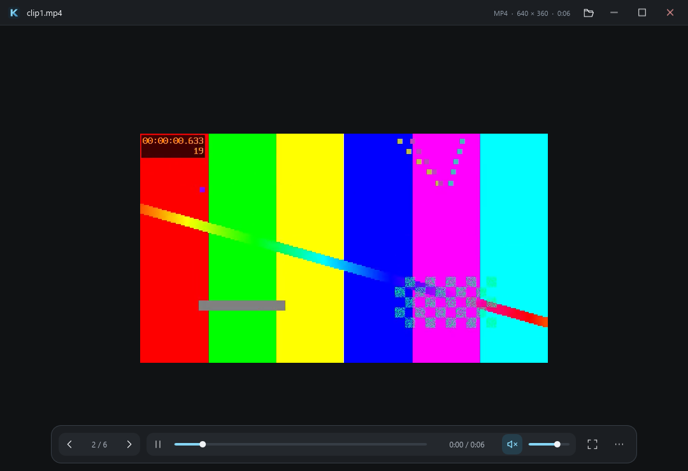

# Local video and audio

Kova Image uses a bundled playback-only FFmpeg 8.1.3 build and dav1d 1.5.3 for
video. Their DLLs ship beside the executable; the application never launches
an external player, downloads codecs or searches for plugins. Rebuild with
`scripts/build-ffmpeg.ps1`; SHA-256-pinned source archives and matching build
recipes are included in binary packages under `decoder-sources`.
Audio-only files retain Windows Media Foundation Media Engine.

## Playback contract

- Containers: MP4/M4V, MOV, WebM and MKV, identified by headers. Bundled video
  decoders include H.264, HEVC, AV1, VP8/VP9, MPEG-1/2/4, WMV/VC-1, MJPEG,
  ProRes, DNxHD, Theora, FFV1, HuffYUV and CineForm. Bundled track decoders
  include AAC, AC-3/E-AC-3, DTS, TrueHD, MP3, Opus, Vorbis, FLAC, ALAC and PCM.
  An unsupported codec or invalid file reports an error and retains navigation.
- Play/pause, finite duration/current time, seek, mute/volume, optional loop,
  fullscreen and mixed-media folder navigation are implemented.
- Left/Right navigate files; Ctrl+Left/Right seek five seconds. Space controls
  playback and M controls mute. Focused sliders use arrow keys instead of navigation.
- Image transforms and clipboard frame extraction do not apply to video.
  Ctrl+C and Ctrl+Shift+C copy the video path. Fullscreen fits video to the
  entire viewport, including upscaling smaller sources.
- Autoplay and looping are separate from animated-image settings. Minimized or
  occluded windows pause video/audio while retaining the user's pause preference.
  Moving and resizing the window keep playback running: the frameless title bar
  and all eight edge/corner grips apply bounds without entering a native modal
  move/resize loop, which would stall frame delivery.
- Each launch owns its window. There is no background service or IPC protocol.

The native worker initializes only for media. Video uses software decoding;
WASAPI's playback clock drives its picture timing. Timestamped PCM keeps delayed
audio tracks and gaps in their positions, and drops audio that arrives after
its playback time. Files without audio use a monotonic clock. Audio-only files
continue to use Media Engine's synchronization.
The app polls for new native frames at approximately 60 Hz while playing. Decode,
scaling and delivery time are subtracted from that interval, so a busy frame
does not incur another full 16 ms sleep. Polling slows while paused/hidden.
Static images never use this worker. Video frames and commands use bounded
coalescing mailboxes.

Windows condition-variable timeouts can otherwise exceed the remaining frame
budget because of the default timer resolution. The worker requests a 1 ms
timer period only while a video is playing and visible. A guard balances each
successful `timeBeginPeriod(1)` with `timeEndPeriod(1)` when playback pauses,
becomes hidden, ends, stops, changes source, fails or the worker exits. Audio-only
playback does not request this period. The worker still sleeps; it does not spin.

This precision has a power cost: more frequent wakeups can reduce CPU sleep time.
On Windows 10 version 2004 and later the request applies to the calling process;
older Windows versions can change the system-wide period. Windows 11 does not
guarantee the requested resolution for an occluded or minimized window. Kova
pauses hidden playback and releases its request. These are Windows timer
semantics, not a guarantee of exact wakeups or display synchronization. See
[Microsoft's timer-period contract](https://learn.microsoft.com/en-us/windows/win32/api/timeapi/nf-timeapi-timebeginperiod)
and the [controlled pacing measurements](VIDEO_MEASUREMENTS.md#ffmpeg-worker-pacing-2026-10-23).



## Limits and tradeoffs

Only regular local drive files up to 32 GiB are admitted. UNC and mapped network
video paths, leaf reparse points other than cloud-sync placeholders, playlists
and URL sources are rejected. A
read-only retained handle denies concurrent writes/deletion. Seeking reads this
same handle through decoder callbacks (a COM stream for audio-only files), rather
than reopening the filename.

MP4/MOV metadata traversal rejects external data references, reference movies,
compressed movie headers, malformed sizes and excessive nesting/box counts.
Container payloads are skipped with seeks. FFmpeg receives read/seek callbacks
over the retained handle. Its protocol list is empty and secondary IO opens are
denied; playlists and external media sources cannot be resolved. The MF audio
path receives an IStream with a synthetic hint and disables local plugins.

Native dimensions are checked when available: maximum 8,192 per side and
16,777,216 pixels; duration must be finite, positive and at most seven days.
The presentation surface fits the current window and is capped at 3840 x 2160,
preserving aspect ratio and never enlarging a smaller source. A larger monitor
still receives at most a 4K presentation buffer. Software scaling and Slint upload use CPU buffers.
Each maximum RGBA presentation buffer is about 33 MiB at 3840 × 2160. A rotated
video can need another buffer of that size. One pending native frame, one retained
native display frame, one recycled spare buffer (at most another 33 MiB), decoder
reference surfaces and renderer textures cost additional memory. The spare is
reused across frames and never grows into a frame queue.
Stereo 48 kHz float PCM is queued for at most two seconds;
the WASAPI endpoint buffer is at most one second. FFmpeg decoders and metadata
probe decoders receive the pixel/sample limits. Individual FFmpeg allocations
are limited to 64 MiB. Native-library allocations are not a total-process RAM cap.

If a video has a decoded audio track but no WASAPI output endpoint can be opened,
its picture continues on a monotonic clock with a visible silent-playback
notice. The failure does not prevent the video from opening. Audio decoder
errors still report a playback error; this is not a fallback for missing codecs.

Native codecs may allocate before reporting dimensions. These are application
admission limits, not a total-process RAM cap or decoder sandbox. Rust cannot
catch native access violations. OS codec/device loss, hostile-file corpora,
HDR tone mapping, unusual aspect ratios and Windows N
installations need broader validation. No subtitles, streaming, playlists, DRM
or codec settings are provided; audio files are played as described below.

## Audio

Audio files go through the same admission, player and controls as video; the
player runs Media Engine in its audio-only mode, so no Direct3D device is created
and nothing is drawn per frame. The state is checked ten times a second.

- Formats, identified by content (an extension decides only for a bare MPEG or ADTS
  stream): MP3 (with or without ID3 tag), M4A/M4B (MP4 audio, by brand or extension),
  AAC (ADTS), WAV, FLAC, Ogg Vorbis, Opus and WMA (ASF with the `.wma` extension).
  Windows must have a decoder for the actual codec; Windows decodes MP3, AAC, WAV,
  FLAC and WMA itself, but not Ogg Vorbis or Opus, which need Microsoft's free
  "Web Media Extensions" from the Microsoft Store. Without them a clear message
  says so (`MF_E_UNSUPPORTED_BYTESTREAM_TYPE`).
- M4A files are checked for external data references like MP4. WMA (ASF) files are
  handed to Windows' own ASF source without inspection by Kova Image.
- Windows reports no duration for a FLAC shorter than about one second, and such a
  file is refused with "Invalid or unsupported media duration". WAV variants that
  Media Foundation does not read (big-endian RIFX, RF64) are not admitted.
- `src/audio.rs` reads the title, artist, album and cover before playback:
  ID3v2.2 to 2.4 and ID3v1 (MP3, and AAC or FLAC with a tag in front), the iTunes
  `ilst` atoms of M4A, and the Vorbis comment and picture blocks of FLAC. Tags are
  best effort and bounded (16 MiB for a tag or block, 32 MiB for `moov`, 16 MiB for
  a picture, 48 MiB read from one file in total, 200 characters for a text, at most
  10,000 comments); a damaged tag is ignored. The file is read in pieces of 1 MiB and
  reading stops as soon as another file is requested, so the single decode worker is
  never kept busy by a tag. The cover is decoded by the viewer's own image decoders at the size of
  the window and is not enlarged. WAV, Ogg, Opus and WMA show no tags.
- A song with a cover shows it like a picture; one without shows a panel with the
  title (or the file name), artist and album. The file information lists the tags.
- Navigation, autoplay, looping, volume, mute, minimizing and Ctrl+Left/Right seeking
  work as for video. The slideshow (F5) waits for a song to end and then moves on to the
  next file, so a folder of songs plays one after another (`ui-smoke.py --state=audio`
  checks it). Image transforms do not apply.

## Reproducible checks

To build the bundled decoders, install MSYS2 into the workspace's ignored
`artifacts/ffmpeg/msys64` directory, initialize its package database, then run
`scripts/build-ffmpeg.ps1`. A separate MSYS2 path can be passed with `-MsysRoot`.
The script uses Visual Studio x64, MSYS2 make/nasm/pkgconf and an isolated Python
environment with Meson/Ninja. Only the pinned FFmpeg and dav1d source archives
are linked into the app, dynamically, with GPL/nonfree features excluded.

```powershell
python scripts/video-fixtures.py
python scripts/video-fixtures.py --codecs
python scripts/video-fixtures.py --tests
python scripts/audio-fixtures.py
cargo run --locked --example audio_probe -- tests/fixtures/tone.mp3
cargo run --locked --example audio_scan -- list-of-audio-paths.txt
python scripts/ui-smoke.py --state=audio
cargo run --locked --example video_probe -- artifacts/video-fixtures/clip1.mp4
cargo run --locked --example video_probe -- artifacts/video-fixtures/clip2.mov
cargo run --locked --example video_probe -- artifacts/video-fixtures/clip4.mkv
cargo run --locked --example video_probe -- artifacts/video-codecs/hevc-aac.mkv
cargo run --locked --example video_probe -- artifacts/video-codecs/h264-ac3.mkv
cargo run --locked --example video_probe -- --pacing
cargo build --locked
python scripts/ui-smoke.py --state=video
python scripts/ui-smoke.py --state=video --software
python scripts/ui-smoke.py --state=codec --path=artifacts/video-codecs/hevc-aac.mkv --software
```

The fixture script needs a developer-installed FFmpeg or `imageio-ffmpeg`.
It creates synthetic six-second test patterns with an audio tone. The native
probe mutes audio and checks real RGBA frames, pause/seek, end-of-file, looping
and file-handle release after acknowledged Stop. GUI tests mute their own test
instance and verify timeline, controls, fullscreen and mixed/stale navigation.
Device-dependent playback probes are opt-in; admission and bundled decoder tests run
in ordinary Cargo CI without requiring sound/GPU devices.
The opt-in `video_probe --pacing` uses a silent 60 fps fixture and a simulated
10 ms upload callback. An optional path selects another 60 fps test clip. It
counts worker frame deliveries, not displayed frames, and reports the observed
callback time. Host load affects this real-time check; it does not run in CI.

The Windows Media Foundation implementation previously failed on HEVC, AC-3,
VP9/Opus and VP8/Vorbis on the development machine. The bundled decoder checks
now cover those tracks plus AV1, E-AC-3 and DTS. Cargo tests decode generated
HEVC/AC-3, AV1/Opus and VP9/Vorbis files without a sound device, and compare
rotation, sample aspect ratio, BT.709 and full-range color against reference PNGs.
See [VALIDATION.md](VALIDATION.md) for the current execution record and
[VIDEO_MEASUREMENTS.md](VIDEO_MEASUREMENTS.md) for current worker pacing checks
and separately labelled historical MF measurements.

Primary API references: [FFmpeg custom IO](https://ffmpeg.org/doxygen/8.0/avio_read_callback_8c-example.html),
[FFmpeg decoding](https://ffmpeg.org/doxygen/trunk/demux_decode_8c-example.html),
[WASAPI](https://learn.microsoft.com/en-us/windows/win32/api/audioclient/nf-audioclient-iaudioclient-initialize),
[FFmpeg licensing](https://ffmpeg.org/legal.html),
[Media Engine byte streams](https://learn.microsoft.com/en-us/windows/win32/api/mfmediaengine/nf-mfmediaengine-imfmediaengineex-setsourcefrombytestream),
[Media Foundation formats](https://learn.microsoft.com/en-us/windows/win32/medfound/supported-media-formats-in-media-foundation),
[MPEG-4 source](https://learn.microsoft.com/en-us/windows/win32/medfound/mpeg-4-file-source),
[MKV source](https://learn.microsoft.com/en-us/windows/win32/medfound/mkv-support).
